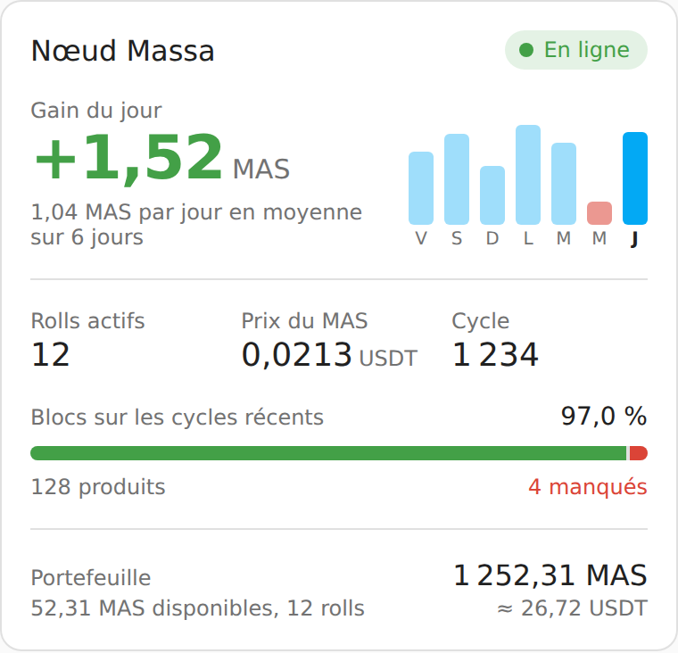

# Massa node card

A Home Assistant card to follow your Massa node: gain of the day with the last 7 days,
active rolls, MAS price, current cycle, produced/missed blocks and, optionally, the wallet.

It works with the [massa_node](https://github.com/kevin-briand/massa_node) integration
and is translated in English and French.



## Installation

### With HACS
- Go to the HACS panel
- Select the 3 dots in the top right corner > Custom repositories
- Paste https://github.com/kevin-briand/HA-massa-node-card and select the *Dashboard* category
- Download **Massa Node Card** and reload the page
- Edit a dashboard > Add card > **Massa Node Card**

### Manual
- Copy `dist/massa-node-card.js` to `/config/www/`
- Add `/local/massa-node-card.js` as a JavaScript module in the
  [dashboard resources](https://developers.home-assistant.io/docs/frontend/custom-ui/registering-resources/)
- Reload the page and add the card

## Configuration

Everything can be set from the visual editor.

| Option | Default | Description |
| --- | --- | --- |
| `title` | Massa node | Card title |
| `device_id` | first Massa node found | Node to display when several wallets are configured |
| `show_history` | `true` | Show the last 7 days next to the gain of the day |
| `show_wallet` | `false` | Show the wallet amount and its value |

```yaml
type: custom:massa-node-card
show_wallet: true
```

The entities are found through the integration, so renaming them does not break the card.
Tap any value to open its history.

## Development

```bash
npm install
npm run watch      # rebuilds dist/massa-node-card.js on every change
npm run typecheck
```
